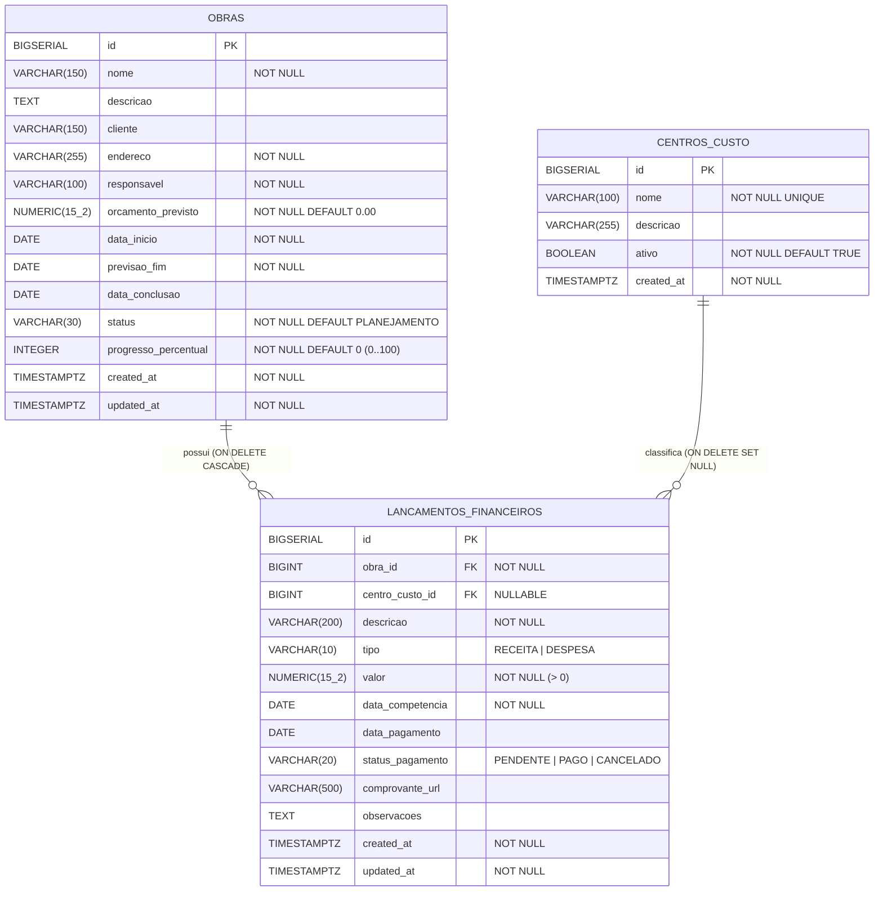

# 🗄️ Modelagem de Dados (DER) & Migrations Flyway

Este documento descreve o modelo relacional do banco de dados **PostgreSQL** do sistema **Gestão de Obras** e a estratégia de versionamento de schema com **Flyway**.

---

## 1. Diagrama de Entidade-Relacionamento (DER)

---

## 2. Dicionário de Dados

### Tabela `obras`
Armazena o cadastro central de cada obra de construção civil.
- **Constraints de integridade:**
  - `chk_obras_status`: valores permitidos `PLANEJAMENTO`, `EM_ANDAMENTO`, `PARALISADA`, `CONCLUIDA`, `CANCELADA`.
  - `chk_obras_datas`: `previsao_fim >= data_inicio`.
  - `chk_obras_data_conclusao`: `data_conclusao IS NULL OR data_conclusao >= data_inicio`.
  - `chk_obras_orcamento`: `orcamento_previsto >= 0`.
  - `chk_obras_progresso`: `progresso_percentual BETWEEN 0 AND 100`.
- **Índices:** `idx_obras_status`, `idx_obras_cliente`, `idx_obras_data_inicio`.

### Tabela `centros_custo`
Categoriza receitas e despesas para análise gerencial e gráficos do dashboard.
- **Seed inicial (aplicado na `V1`):**
  1. `Materiais de Construção`
  2. `Mão de Obra`
  3. `Equipamentos & Maquinário`
  4. `Projetos & Licenças`
  5. `Serviços Terceirizados`
  6. `Aporte / Receita de Cliente`

### Tabela `lancamentos_financeiros`
Registra todas as movimentações financeiras de entrada (`RECEITA`) e saída (`DESPESA`).
- **Relacionamentos:**
  - `fk_lancamentos_obra` → `obras(id)` com `ON DELETE CASCADE` (excluir a obra remove seus lançamentos).
  - `fk_lancamentos_centro_custo` → `centros_custo(id)` com `ON DELETE SET NULL` (excluir um centro de custo mantém o histórico financeiro intacto).
- **Constraints de integridade:**
  - `chk_lancamento_tipo`: `RECEITA` ou `DESPESA`.
  - `chk_lancamento_status`: `PENDENTE`, `PAGO` ou `CANCELADO`.
  - `chk_lancamento_valor`: `valor > 0`.
- **Índices:** `idx_lancamentos_obra_id`, `idx_lancamentos_centro_custo_id`, `idx_lancamentos_tipo`, `idx_lancamentos_status_pagamento`, `idx_lancamentos_obra_competencia (obra_id, data_competencia DESC)`.

---

## 3. Fluxo de Migrations (Flyway)

O projeto utiliza **Flyway** como única fonte de verdade do schema (`spring.jpa.hibernate.ddl-auto=validate`):

1. **Localização:** `backend/src/main/resources/db/migration/`
2. **Convenção de nomenclatura:** `V<versao>__<descricao_em_snake_case>.sql` (ex.: `V1__create_initial_schema.sql`).
3. **Regra de imutabilidade:** Migrations já aplicadas em ambiente compartilhado nunca devem ser alteradas; evoluções de schema devem ser adicionadas como novas versões (`V2__...`, `V3__...`).
4. **Validação automática:** Ao iniciar a aplicação (ou rodar os testes automatizados), o Flyway aplica migrations pendentes e o Hibernate valida todas as entidades JPA contra o schema real do banco.
